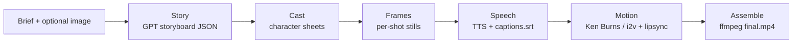

# toon

**Type a short description. Get a cartoon marketing video.** A FastAPI pipeline that turns a text brief (plus an optional reference image) into a finished MP4 — script, characters, voiceover, motion, captions, and music — for roughly **$1–3 of API spend per video**.

<video src="docs/demo.mp4" controls width="360"></video>

## What it does

You write a brief like *"a 30s cartoon about a robot learning to share"*, pick an aspect ratio (9:16 for Shorts/Reels/TikTok, or 16:9), a length (15–45s), and a motion tier. The app runs six stages and hands back a downloadable, captioned MP4 — along with a live per-stage progress view and a running cost estimate.

| Stage | What happens | Provider |
|---|---|---|
| **Story** | GPT writes a shot-by-shot storyboard as validated JSON (speakers, visuals, captions, timing) | OpenAI chat |
| **Cast** | Character sheets drawn for consistency across shots | fal.ai FLUX or gpt-image-1 |
| **Frames** | One still per shot, seeded by an optional uploaded reference image | fal.ai or OpenAI |
| **Speech** | Per-line TTS voiceover + `.srt` captions | OpenAI TTS or ElevenLabs |
| **Motion** | Ken Burns pans on stills — or true image-to-video + optional lip-sync on the *animated* tier | ffmpeg / fal.ai Kling |
| **Assemble** | Audio mix, concat, burned-in captions, optional music bed → `final.mp4` | ffmpeg |



## Quickstart

```bash
python -m venv .venv && .venv\Scripts\activate   # Windows
pip install -r requirements.txt
cp .env.example .env                            # add your keys
winget install Gyan.FFmpeg                      # ffmpeg must be on PATH
python app.py                                   # opens http://127.0.0.1:8787
```

Start a description with `demo:` to walk the UI end-to-end with **zero API calls** — no keys needed. `python smoke.py` runs a zero-cost check of the ffmpeg stages.

## Configuration

| Env var | Default | Purpose |
|---|---|---|
| `OPENAI_API_KEY` | — | Story + TTS + image fallback. Minimum viable key. |
| `OPENAI_MODEL` | `gpt-4o-mini` | Story/vision model |
| `OPENAI_IMAGE_MODEL` | `gpt-image-1` | Image fallback model |
| `FAL_KEY` | — | Enables fal.ai images + animation tier |
| `IMAGE_MODEL` | `fal-ai/flux/dev` | fal.ai image model |
| `VIDEO_MODEL` | — | e.g. `fal-ai/kling-video/v3/standard/image-to-video` |
| `LIPSYNC_MODEL` | — | Optional fal.ai lip-sync model |
| `TTS_PROVIDER` | `openai` | `openai` or `elevenlabs` |
| `ELEVENLABS_API_KEY` / `ELEVENLABS_VOICE_ID` | — | ElevenLabs TTS |
| `MAX_USD_PER_JOB` | `3` | Per-job spend cap — pipeline halts before exceeding |
| `ACCESS_CODE` | — | If set, non-demo generation requires this code in the form |

ffmpeg must be on `PATH` (`winget install Gyan.FFmpeg` on Windows).

## How it works

Each run is a **job** in `output/<id>/` with resumable, atomic JSON state:

```
brief.json  story.json  status.json  spend.json  meta.json  captions.srt
cast/  frames/  audio/  clips/  final.mp4
```

- **Resumability** — every stage skips already-produced artifacts, so a failed run resumes where it stopped
- **Cost governance** — `toon/spend.py` charges an estimated rate *before* each provider call and raises `BudgetExceeded` at the per-job cap
- **Provider fallbacks** — images: fal.ai → OpenAI; speech: ElevenLabs → OpenAI; motion: i2v → Ken Burns stills
- **Safety on uploads** — validated job IDs, upload type/size limits, path-traversal guards on file serving

## Deployment

`Dockerfile` produces a self-contained image (Python 3.11 + ffmpeg). Deploy on Render/Railway/fly.io:

```dockerfile
docker build -t toon . && docker run -p 8000:8000 --env-file .env toon
```

The `seed/` folder is baked into `/app/output/` so the "Past videos" list shows a finished example immediately. **Set `ACCESS_CODE` on any public deployment** — otherwise anyone can spend your API keys. `demo:` briefs always run free.

## Testing

```bash
pytest            # unit tests (jobs, story validation)
python smoke.py   # zero-cost end-to-end check of speech/motion/assemble via ffmpeg
```

## Stack

Python 3.11 · FastAPI + uvicorn · httpx · OpenAI API · fal.ai queue API · ElevenLabs · ffmpeg (libx264/AAC, zoompan, subtitles, amix) · vanilla-JS single-page UI

## Notes

- Output is H.264 + AAC, yuv420p — YouTube/Shorts-ready out of the box
- `meta.json` flags `ai_generated: true` for platform disclosure requirements
- On Windows, ffmpeg's subtitle filter is driven from the job directory (absolute paths break the filter parser) — see `toon/assemble.py`
